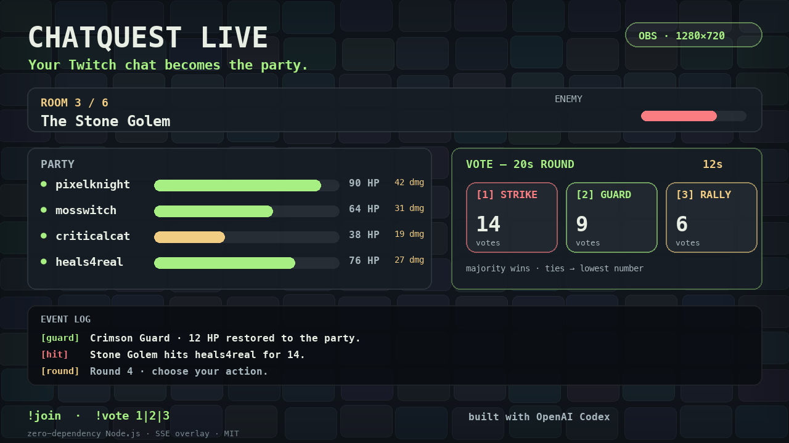

# ChatQuest Live

Your Twitch chat is the party. Six viewers explore six rooms, vote on combat every 20 seconds, and face **The Lag Lord**, a two-phase boss. A CSS pixel dungeon overlay streams state straight into OBS. Node.js 22+, ESM, zero npm dependencies, no build step, no external assets or fonts.



## Inspiration
Chat is normally a passive audience: they watch, they type, and the streamer plays alone. I wanted to flip that — make chat the party. ChatQuest Live turns a Twitch channel into a shared tabletop dungeon crawl that viewers join from chat and that renders as a live OBS overlay.

## What it does
- Viewers type `!join` to join the party (max 6, 100 HP each) and vote every 20 seconds: `!vote 1` **Strike**, `!vote 2` **Guard**, `!vote 3` **Rally** (also `!1`/`!2`/`!3`). Majority wins; ties go to the lowest number.
- Six rooms with escalating enemies, ending in a two-phase boss. Downed viewers can be revived by Rally; a full wipe restarts the run with a fresh party.
- An OBS browser-source overlay shows room depth, party HP and damage, enemy HP, live vote counts with a countdown, and a rolling event log — retro dungeon-terminal style, CSS-only art.
- Reads Twitch chat **anonymously over IRC** (viewers authorize nothing), with an optional authenticated sender mode for round announcements and a deterministic demo simulator for offline demos.

## How we built it
Built with **OpenAI Codex** in one thread. I wrote a detailed spec (game rules, overlay requirements, zero-dependency constraints, acceptance tests) and Codex implemented the pure game engine, the Twitch IRC client, the SSE server, the overlay renderer and the test suite — then ran `npm test` and fixed the failures. Stack: Node.js 22, ESM, zero npm dependencies (`node:` builtins only). Codex session ID: `01a17e0d-66b5-72b3-9a2e-ccb7949a786b` (see [`CODEX_SESSION.md`](CODEX_SESSION.md)).

## Challenges
- Keeping the game deterministic for tests while feeling random to players — solved with a seeded RNG injected in tests.
- Implementing Twitch IRC safely (PING/PONG keepalive, reconnect, malformed lines) with no npm dependency — hand-rolled TLS line parser plus a fuzz-ish malformed-input test.
- Making HP bars, vote counts and the event log readable at stream scale in a 1280×720 capture.

## Accomplishments
- A complete interactive Twitch experience with an OBS-ready overlay, no build step and no viewer OAuth.
- A real game loop tuned for stream pacing (20s rounds, six rooms, ~5-minute run) instead of a tech demo.
- 23 tests covering party limits, majority/tie-break, Guard reduction, Rally revive, wipe/restart, boss phases, victory, seeded RNG and live HTTP/SSE responses.

## What we learned
- How far a strict spec + Codex can go for a real-time app with a hard UI constraint (OBS at 1280×720).
- Twitch IRC's anonymous read path is a great low-friction way to build chat interactivity without OAuth.
- Spectator-first design: every state change has to be visible on the overlay, not just in chat.

## What's next
- Twitch EventSub (subs, raids, channel-point redemptions) as special moves.
- Per-channel leaderboards and persistent meta-progression between streams.
- An optional LLM dungeon master narrating rooms in the streamer's voice.

## Built with
`node.js` · `javascript` · `openai-codex` · `twitch` · `irc` · `server-sent-events` · `html` · `css` · `obs`

## Try it in 60 seconds

From this directory:

```sh
npm test
npm run demo
```

Open **http://localhost:8787/overlay**. The party appears immediately; the first action resolves after 20 seconds. Watch live votes, late joins, HP loss, Guard and Rally. The deterministic run wins in approximately **3 minutes**, then restarts after 30 seconds with a fresh party. No internet or Twitch account is needed for demo mode. No `npm install` is necessary.

In another terminal, inspect the server:

```sh
curl -fsS http://localhost:8787/state
curl -N http://localhost:8787/events
```

The status page is **http://localhost:8787/**. Stop with Ctrl+C. Override the port with `PORT=9000 npm run demo`.

## Run live on Twitch

```sh
TWITCH_CHANNEL=your_channel_login npm start
```

Use the channel login, without a Twitch URL (`#` prefix is accepted). The server reads Twitch IRC over verified TLS at `irc.chat.twitch.tv:6697`, using an anonymous `justinfan` identity. No credentials are needed for reading. The HTTP server binds only to `127.0.0.1`. Live mode only contacts Twitch; demo mode makes no external network calls.

Open your channel chat and type `!join`. Up to six unique viewers can join, including during combat. Members vote with `!vote 1`, `!vote 2`, `!vote 3`, or `!1`, `!2`, `!3`. Commands ignore case. A later vote replaces your earlier vote. Unjoined users cannot vote. `!help` logs instructions locally; bot mode also sends them to chat. Command and connection activity appears in the terminal.

With no `TWITCH_CHANNEL`, live mode exits with an actionable error. Connection failures retry with backoff up to 30 seconds. Check the overlay's connection label and server log when diagnosing chat connectivity.

### Optional sending bot

Reading works without a bot. To send announcements, use an account you control and a user OAuth token for that account.

1. Register an application in the [Twitch developer console](https://dev.twitch.tv/console/apps), with redirect URI `http://localhost:8787/`.
2. While logged in as the bot account, open this URL, replacing `YOUR_CLIENT_ID`:

   ```text
   https://id.twitch.tv/oauth2/authorize?client_id=YOUR_CLIENT_ID&redirect_uri=http%3A%2F%2Flocalhost%3A8787%2F&response_type=token&scope=chat%3Aread%20chat%3Aedit&state=chatquest_local_setup
   ```

3. Approve access. Copy only the `access_token` value from the redirected URL fragment. Keep it private and clear the fragment afterward.
4. Set `TWITCH_BOT_NAME` to that account's login and `TWITCH_OAUTH_TOKEN` to the token (with or without `oauth:`).

The [official OAuth guide](https://dev.twitch.tv/docs/authentication/getting-tokens-oauth/#implicit-grant-flow) explains this flow. Twitch IRC uses the [`chat:read` and `chat:edit` scopes](https://dev.twitch.tv/docs/chat/irc/). Tokens expire; generate a replacement when necessary.

`.env.example` lists the supported names with empty values. To load a private `.env`, use Node's built-in loader:

```sh
node --env-file=.env src/server.js
```

Set both bot variables together, or leave both empty. The bot sends round announcements, action summaries, room clears, boss phases, outcomes and help with a bounded, rate-limited queue. Tokens are never included in logs, `/state`, or SSE. No client secret is required by this project. `.env` is ignored by version control.

## Add to OBS

1. Run the server on the same machine as OBS.
2. Add **Sources → Browser**. Name it `ChatQuest Live`.
3. Set URL to `http://localhost:8787/overlay`, **Width 1280**, **Height 720**.
4. Leave browser audio disabled; the overlay has no audio.
5. Place the source in your scene. Refresh its cache if you change the source files.

The logical canvas remains 1280×720 and scales proportionally in smaller browser windows. It uses system monospace fonts, CSS-only monster art, glowing health bars, damage flashes and reduced-motion support. There are no image, font, CDN or analytics requests.

## Rules

- Six fixed rooms: Moss Slime, Bat Swarm, Stone Golem, Bone Wraith, Ember Drake, The Lag Lord.
- Each member joins at 100 HP. At zero they are downed, cannot vote or attack, and remain in their party slot until revived or the run ends.
- **Strike:** each living member rolls 14 damage, with a seeded 12% chance of double damage. Effective damage is capped to enemy HP and credited proportionally across attackers.
- **Guard:** every living member recovers up to 6 HP; incoming damage is halved, rounded down. No attack damage.
- **Rally:** the weakest living member recovers up to 32 HP, and one downed member returns with 35 HP. No attack damage.
- The enemy hits one seeded random living member after every action, even a killing blow. A wipe takes precedence if the final enemy strike downs the last hero.
- Majority wins; ties choose the lowest action number. Zero votes defaults to Strike.
- The boss revives into phase II with 64 HP and 48 attack. Victory requires defeating both phases.
- Wipe and victory screens last 30 seconds. Restart clears the party, rooms and round count; viewers must join again. Demo viewers rejoin automatically.
- The demo schedules defensive rounds and close votes; the same initial seed and chat timeline produce the same run. Live run duration varies with party size and votes.

## Architecture and testing

- `src/game.js`: pure clock-injected state machine, seeded RNG, commands and structured events. `command(user, text)` handles chat; `tick(now)` advances a deadline; `snapshot()` returns an independent JSON-safe state. Time is milliseconds. A delayed tick resolves one round and opens a fresh full voting window rather than skipping unseen rounds.
- `src/chat.js`: buffered IRC/TLS reader, PING/PONG, reconnect, safe parser and optional bot sender.
- `src/server.js`: HTTP routes, 250ms state broadcasts, bounded SSE backpressure, deterministic chat simulation, process shutdown. Exports a server factory for integration tests.
- `public/`: CSS-only overlay and safe DOM renderer. EventSource reconnects automatically with a two-second retry; countdowns interpolate locally between state snapshots. Reconnects receive a complete snapshot.
- `test/`: Node's built-in test runner covers party limits, vote changes/majorities/ties, combat, healing/revival, wipes, room/boss progression, victory/restart, deterministic RNG, full virtual demo runs, malformed IRC and actual local HTTP/SSE responses.

Run `npm test`. The full campaign is exercised with a virtual clock, so the tests finish in seconds. Fetch `/overlay`, `/style.css`, and `/app.js` to check the served assets. `/state` returns the same structured state sent as `event: state` on `/events`, including bounded recent events, vote counts and absolute round deadlines. No text parsing drives gameplay or rendering.

MIT licensed. See `LICENSE`.
